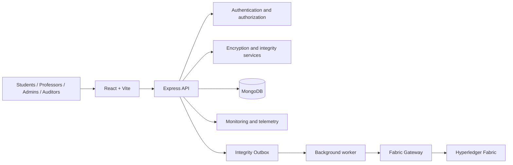
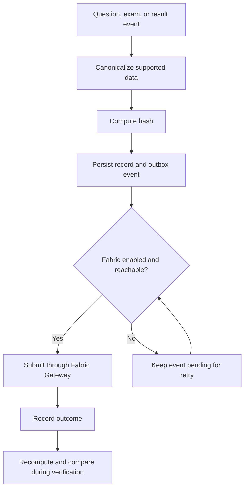

# ZeroLeak
### A Zero-Trust Secure Examination Platform

ZeroLeak is a secure examination and assessment platform designed to protect exam integrity, reduce opportunities for cheating, surface suspicious activity, and make supported records verifiable. It combines role-based access control, encrypted question content, exam monitoring, cryptographic hashing, and optional Hyperledger Fabric integrity commitments.

> **Data separation:** MongoDB is the operational system of record. When configured, Hyperledger Fabric stores cryptographic commitments for integrity verification—not plaintext examination questions, answers, credentials, or other sensitive application payloads.

## Contents
- [Overview](#overview)
- [Core capabilities](#core-capabilities)
- [Architecture](#architecture)
- [Integrity workflows](#integrity-workflows)
- [Technology stack](#technology-stack)
- [Repository structure](#repository-structure)
- [Prerequisites](#prerequisites)
- [Local setup](#local-setup)
- [Environment configuration](#environment-configuration)
- [Hyperledger Fabric](#hyperledger-fabric)
- [Docker](#docker)
- [Testing and commands](#testing-and-commands)
- [Deployment](#deployment)
- [Security considerations](#security-considerations)
- [Troubleshooting](#troubleshooting)
- [Documentation](#documentation)
- [Roadmap](#roadmap)
- [Contributors](#contributors)
- [License](#license)

## Overview

Online examinations must balance accessibility with confidentiality, fairness, and auditability. ZeroLeak uses layered controls to protect exam workflows and support investigation of suspicious activity:

- Role-based access control for distinct user workflows.
- Encryption services for supported question content.
- Server-side validation of submitted answers.
- Monitoring and telemetry for supported anti-cheating workflows.
- Cryptographic hashes and Merkle-tree logic for integrity checks.
- Optional blockchain anchoring through Hyperledger Fabric.

ZeroLeak is a development project. Security-sensitive features must be tested and reviewed in the intended deployment environment before use in high-stakes examinations.

## Core capabilities

### Roles and access
The project provides workflows for:

| Role | Intended responsibilities |
|---|---|
| **Student** | Access assigned exams, submit answers, and view permitted results. |
| **Professor** | Manage questions and examination workflows. |
| **Admin** | Manage users and platform operations. |
| **Auditor** | Inspect supported integrity records and run verification workflows. |
| **Support** | Use a dedicated support workflow. |

Authorization must be enforced by backend middleware and route logic; hiding a frontend control is not a security boundary.

### Exam validation
- Validate submitted answers against questions assigned to the exam attempt.
- Treat missing answers as unanswered rather than coercing them to option zero.
- Require selected option indexes to be integers within the question's valid range.
- Reject malformed or out-of-range values through server-side validation.

### Monitoring and anti-cheating
ZeroLeak is designed to surface suspicious exam activity for review. Monitoring signals are indicators, not automatic proof of misconduct; browser events and remote monitoring have technical limitations and should be explained to candidates in advance.

### Live proctoring
The project includes a WebRTC-oriented monitoring design and Socket.IO telemetry for administrative views. Actual behavior depends on implementation, browser permissions, network conditions, and deployment configuration.

### Cryptographic integrity
- Compute hashes from consistently canonicalized data.
- Use Merkle-tree logic for supported question collections.
- Recompute hashes from underlying content during verification where supported, rather than trusting only a mutable hash field.
- Treat decryption or canonicalization failures as verification failures.

### Hyperledger Fabric
When enabled and connected, the Fabric integration is intended to record commitments for supported questions, exams, and results. A MongoDB-backed `IntegrityOutbox` queues commitments for asynchronous delivery and retry.

**A pending outbox event is not a confirmed ledger commitment.** Operational views should distinguish queued, submitted, and failed work.

### Analytics
The frontend uses Recharts for supported visualizations of exam activity, performance, and operational metrics. Available metrics depend on the data and endpoints implemented in the current version.

## Architecture



| Component | Responsibility |
|---|---|
| Frontend | Role-specific interfaces, exam interactions, dashboards, integrity views. |
| Backend API | Authentication, authorization, validation, exam workflows, business logic. |
| MongoDB | Operational records, encrypted content, results, and outbox events. |
| Cryptography services | Content encryption/decryption and supported hashing workflows. |
| Outbox and worker | Queue and retry integrity commitments. |
| Hyperledger Fabric | Ledger-backed storage and verification of supported commitments. |
| Redis | Optional supporting infrastructure for configured rate limiting, caching, or coordination. |

### Data separation
MongoDB stores application records needed to run the platform. The ledger should store hashes and commitment metadata only. Hashing is not encryption; low-entropy inputs may be guessable. Use a well-defined canonicalization and commitment strategy.

## Integrity workflows

### Examination workflow
1. An authorized professor prepares examination content.
2. The backend validates and stores supported question data.
3. An eligible student accesses an assigned exam.
4. The backend validates submitted answers and option indexes.
5. The application records the result and initiates supported integrity commitment workflows.
6. Authorized users inspect permitted results and monitoring information.

### Commitment workflow


This is a conceptual workflow. Exact transaction boundaries, retry policies, and state transitions depend on the implemented services.

### Verification principle
A verification operation should recompute the expected hash from the current underlying data and compare it with a trusted ledger commitment. Comparing a ledger value only with a hash field stored beside the data is insufficient if both database fields could be altered by the same attacker.

## Technology stack

| Layer | Technologies |
|---|---|
| Frontend | React 19, Vite, React Router |
| Charts and icons | Recharts, Lucide React |
| Backend | Node.js, Express 5 |
| Data access | MongoDB, Mongoose |
| Authentication | JSON Web Tokens (JWT), bcrypt |
| Background tasks | Node-Cron and project-specific workers |
| Real-time features | Socket.IO; WebRTC-oriented monitoring |
| Integrity ledger | Hyperledger Fabric, Fabric Gateway |
| Cryptography | SHA-256-based hashing, Merkle-tree logic, project crypto services |
| Infrastructure | Docker Compose; Redis where configured |
| Hosting | Frontend and backend can be deployed separately; Fabric must be reachable by the backend |

Confirm exact versions and enabled integrations against the current `package.json` files, lockfiles, and deployment configuration.

## Repository structure

```text
ZeroLeak-v2/
├── backend/                  # Express API, controllers, models, services
├── frontend/                 # React + Vite application
├── fabric/
│   ├── chaincode/
│   │   └── zeroleak-integrity/
│   ├── infrastructure/       # Fabric binaries, config, test network
│   └── scripts/              # Network, deployment, and status scripts
├── docker-compose.yml
├── docker-stack.yml
├── render.yaml               # If used by this branch
├── FABRIC.md                 # Fabric integration guide
├── MONGODB_README.md         # MongoDB implementation notes
├── package.json              # Root-level scripts
└── README.md
```

Paths can vary by branch. Check the current repository before relying on optional files.

## Prerequisites

- Node.js 20 or later and npm.
- Git.
- MongoDB, local or hosted.
- Docker Engine and Docker Compose for containerized services or the local Fabric test network.
- Hyperledger Fabric binaries, images, and test-network assets if using Fabric locally.

Fabric is optional for ordinary application development when `FABRIC_ENABLED=false`.

## Local setup

### 1. Clone the repository
```bash
git clone <YOUR_REPOSITORY_URL>
cd ZeroLeak-v2
```
Replace the placeholder with your repository URL.

### 2. Install dependencies
From the repository root:
```bash
npm install
npm install --prefix backend
npm install --prefix frontend
npm install --prefix fabric/chaincode/zeroleak-integrity
```

If `npm run install:all` exists and works for your branch, it may be used instead. If it fails, use the individual commands and inspect the root script for path or formatting issues.

### 3. Configure the backend
Create the environment file expected by the backend configuration loader (commonly `backend/.env`) and use the repository's example file if available. Never commit actual secrets.

### 4. Start the services
In separate terminals from the repository root:
```bash
npm run start:backend
```
```bash
npm run start:frontend
```

To run both concurrently, if the root script is configured:
```bash
npm run dev
```

Use the URLs and ports printed by the development servers. If startup fails, inspect the relevant service logs and package scripts.

## Environment configuration

Variable names are project-specific. Check backend configuration code and existing example files before adding variables. The following is a **template, not a guaranteed complete schema**:

```dotenv
NODE_ENV=development
PORT=5000
FRONTEND_URL=http://localhost:5173

# Use the exact database variable name expected by the backend.
MONGODB_URI=<YOUR_MONGODB_CONNECTION_STRING>

# Generate strong, unique secrets; confirm exact names in the code.
JWT_SECRET=<YOUR_LONG_RANDOM_JWT_SECRET>
# ENCRYPTION_KEY=<YOUR_SECRET_ENCRYPTION_KEY>

# Optional: only if Redis is enabled and required.
# REDIS_URL=redis://:<YOUR_REDIS_PASSWORD>@localhost:6379

# Hyperledger Fabric
FABRIC_ENABLED=false
FABRIC_CHANNEL_NAME=zeroleak-channel
FABRIC_CHAINCODE_NAME=zeroleak
FABRIC_MSP_ID=Org1MSP

# Configure only when Fabric is enabled and paths are valid
# for the backend's runtime environment.
# FABRIC_CRYPTO_PATH=<PATH_TO_ORG1_PEER_ORGANIZATION>
# FABRIC_TLS_CERT_PATH=<PATH_TO_TLS_CA_CERTIFICATE>
```

Notes:
- The code may expect `MONGO_URI` or another variable instead of `MONGODB_URI`; use the exact name in the code.
- JWT and encryption variable names must match the backend services.
- Placeholders are not valid credentials.
- Do not commit `.env`, private keys, Fabric identities, TLS private material, or production connection strings.
- Set secrets in the hosting provider's environment settings.
- Local paths from a laptop or Codespaces do not automatically exist on Render or another remote host.
- Keep Fabric disabled until its network, chaincode, identity, certificates, and backend connectivity are configured.

## Hyperledger Fabric

The repository includes scripts for a **development/test Fabric network**. A test network is not, by itself, a production blockchain deployment.

### 1. Read the integration guide
See [`FABRIC.md`](./FABRIC.md) for project-specific network, chaincode, and backend configuration.

### 2. Check Docker
```bash
docker --version
docker compose version
docker info
```

### 3. Start the test network
```bash
npm run fabric:up
```
The script uses `fabric/infrastructure` by default and creates the configured channel. Binaries, scripts, and container images must be compatible and built for the current runtime architecture.

### 4. Deploy chaincode
```bash
npm run fabric:deploy
```
The script builds the TypeScript chaincode and deploys it using Fabric test-network tooling. Confirm the channel, chaincode name, language, version, and sequence match the backend configuration.

### 5. Check status
```bash
npm run fabric:status
```
This reports detected containers and attempts a ledger query when the required CLI assets are available. Running containers alone do not prove that the channel or chaincode is healthy.

### 6. Enable the backend
After the network and chaincode are successfully deployed, configure `FABRIC_ENABLED=true` and the required channel, chaincode, MSP, certificate, and identity settings. Restart the backend and inspect logs and outbox states.

### 7. Stop the network
```bash
npm run fabric:down
```
Review `fabric/scripts/network-down.sh` if local ledger state must be preserved. Avoid deleting volumes unless you intentionally want to remove local development data.

**Operational notes**
- The bundled network is for development/testing, not a managed production ledger.
- Gateway connectivity depends on reachable endpoints, TLS certificates, and a valid client identity.
- Docker service names generally resolve inside the Fabric Docker network; they are not automatically reachable from a separately hosted backend.
- A backend on Render cannot use a Codespaces-only `localhost` endpoint or a local certificate path.
- When Fabric is disabled, pending outbox events are not confirmed on-chain until successfully submitted.
- Expose only the minimum required network access and protect identity material.

## Docker

Review Compose files and required variables before starting containers.

```bash
docker compose up --build
docker compose up --build -d
docker compose ps
docker compose logs -f
docker compose down
```

Use any profile or environment file required by your configuration. **Warning:** `docker compose down -v` removes named volumes and may permanently delete local database or ledger data. Use it only when intentionally resetting the environment.

Keep database and cache services on private networks where possible, require strong credentials, and do not expose MongoDB or Redis publicly without a specific secured requirement.

## Testing and useful commands

Run:
```bash
npm run
```
to list scripts available in the current checkout.

| Command | Purpose |
|---|---|
| `npm run dev` | Start frontend and backend concurrently, if configured. |
| `npm run start:backend` | Start the backend development server. |
| `npm run start:frontend` | Start the frontend development server. |
| `npm run install:all` | Install dependencies if the root script is valid. |
| `npm run docker:up` | Start Compose services. |
| `npm run docker:down` | Stop Compose services. |
| `npm run docker:build` | Build Compose images. |
| `npm run docker:prod` | Start the configured production profile. |
| `npm run fabric:up` | Start local Fabric test network. |
| `npm run fabric:deploy` | Build and deploy integrity chaincode. |
| `npm run fabric:status` | Inspect Fabric containers and attempt a ledger query. |
| `npm run fabric:down` | Stop local Fabric network. |
| `npm run fabric:test` | Run the backend test script in the current root configuration. |

Inspect `backend/package.json` to confirm the test runner and test suites. Before a release, test authentication, role authorization, exam assignment, answer validation, encryption/decryption, hash generation, tamper detection, outbox retry behavior, and failure handling when dependencies are unavailable. Report tests as passing only after actually running and checking them.

## Deployment

The frontend and backend can be hosted separately. For example, the React frontend may be on Vercel and the Express API on Render, with MongoDB hosted independently. Hyperledger Fabric is a separate service and must be securely reachable by the backend.

### Frontend
Set the API base URL to the deployed backend. Use the exact variable name expected by the Vite app. Values embedded in browser code are public and must never contain secrets.

### Backend
Configure the database URI, authentication and encryption secrets, allowed frontend origin, and any enabled supporting services in the host's environment settings. Confirm that the service listens on the port required by the host.

### Fabric
Deploy peers, orderers, channel, chaincode, identities, and TLS connectivity independently. A Fabric network running in Codespaces is temporary and should not be treated as a permanent production ledger. If the backend cannot reach a securely deployed ledger, leave Fabric disabled until connectivity and credentials are ready.

## Security considerations

Before using real examinations:
- Enforce authorization on every protected backend endpoint.
- Use strong, unique secrets and rotate exposed credentials.
- Use an appropriate password-hashing algorithm and parameters.
- Store encryption keys separately from encrypted data and backups.
- Validate and normalize untrusted input on the server.
- Rate-limit unauthenticated routes and monitor repeated failures.
- Configure CORS narrowly and use HTTPS for hosted traffic.
- Restrict database and cache access to trusted services.
- Minimize sensitive data in logs and audit records.
- Recompute integrity values from underlying data rather than relying only on mutable hash fields.
- Treat proctoring signals as reviewable indicators; provide appropriate notice and access controls.
- Back up operational data and test restoration.
- Review dependency versions and update runtime images and Fabric components.
- Never publish credentials, `.env` files, private keys, student data, exam answers, or production certificates.

Blockchain anchoring can help detect changes relative to a trusted commitment. It does not automatically secure the whole application, prove that original data was correct, or prevent every form of cheating.

## Troubleshooting

### Frontend cannot reach backend
- Check backend status and logs.
- Verify the frontend API base URL and backend CORS configuration.
- Use the deployed HTTPS URL in production.

### Backend cannot connect to MongoDB
- Confirm the configured environment-variable name and connection string.
- Check credentials, network access, and hosted database allowlists.
- Never share database credentials in public logs.

### Fabric reports missing binaries
- Confirm `fabric/infrastructure/bin/peer` is built for the current Linux runtime and architecture.
- Check `fabric/infrastructure/test-network` and expected configuration directories.
- Ensure binaries, scripts, and images use compatible versions.

### Peer cannot connect to orderer
- Inspect peer and orderer logs and container status.
- Confirm both containers share the expected Docker network and the orderer listens on the configured port.
- Check TLS certificates, endpoint hostnames, and the expected TLS server name.
- DNS resolution alone does not prove TCP or TLS connectivity.
- Preserve logs and volumes before resetting a network.

### Integrity records remain pending
- Confirm the outbox worker is running and Fabric is enabled as intended.
- Check Gateway connectivity, channel and chaincode names, certificates, and identity configuration.
- Pending means queued work, not a successful ledger commit.

## Documentation

- [Fabric Integration Guide](./FABRIC.md) — test network, chaincode deployment, and ledger configuration.
- [MongoDB Documentation](./MONGODB_README.md) — MongoDB and Mongoose implementation notes.
- [Docker Compose](./docker-compose.yml) — local multi-service configuration.
- [Docker Stack](./docker-stack.yml) — stack-oriented deployment configuration.
- [Render configuration](./render.yaml) — if present and used by this branch.

## Roadmap

Potential areas for continued development:
- Broader automated security and integration tests.
- Better outbox observability, retry reporting, and backfill operations.
- Production-grade Fabric deployment and operational monitoring.
- Expanded proctoring and anomaly-review workflows.
- More accessible audit reporting and analytics.
- Deployment hardening, backup/restore validation, and incident-response documentation.

Mark roadmap items complete only after implementation and verification.

## Contributors

- **Ashish Kumar Gupta**
- **Vikhyat Mishra**
- **Yashwant Yadav**
- **Himanshu Soni**

## License

Add the selected project license and include its corresponding `LICENSE` file. Do not claim a license until one has been chosen.
